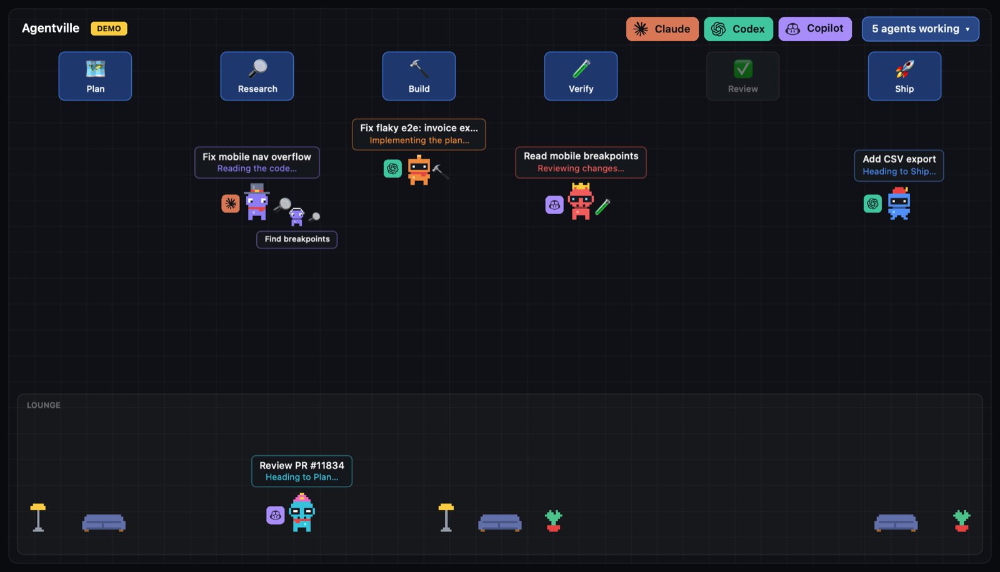

<p align="center"></p>

<h1 align="center">Agentville</h1>

<p align="center">
See your Claude Code, Codex and GitHub Copilot agents at work.<br>
A Mac app that turns every running session into a little cartoon agent.
</p>


## What you get

| | |
|---|---|
| **Working** — each agent stands at the station that matches what it is doing, tool in hand. |  |
| **Idle** — agents waiting on you head to the lounge and fall asleep. |  |
| **Nobody home** — the dog keeps watch until a session starts. |  |
| **Pixel style** — switch the artwork between smooth and pixel art. |  |

<p align="center">


</p>
<p align="center"><em>Open the agent list from the header, or click an agent to see its recent tasks.</em></p>

Also: filter by provider from the legend, keep the window on top, and a menu bar counter of
agents at work.

## Install

Requires macOS 14 or later on an Apple silicon Mac.

**Download**

1. Download `Agentville.zip` from the [latest release](https://github.com/danfar93/agentville/releases/latest) and unzip it.
2. Drag **Agentville** into your Applications folder.
3. The first time, right-click the app and choose **Open**, then **Open** again. The app is not
   notarised by Apple, so a plain double-click is blocked. If macOS still refuses, go to
   **System Settings → Privacy & Security** and click **Open Anyway**.

**Or build it yourself** (needs Xcode 15 or later)

```sh
git clone https://github.com/danfar93/agentville.git
cd agentville
./scripts/bundle.sh
open build/Agentville.app
```

Then start a Claude Code, Codex or Copilot CLI session and its agent walks in.

## How it works

Agentville only reads the session logs these tools already write to `~/.claude`, `~/.codex`
and `~/.copilot`. It changes nothing, needs no sign-in, and makes no network requests.

An agent's station is worked out from what its session is doing:

| Station | When the session is… |
|---|---|
| 🗺️ Plan | planning or updating a to-do list |
| 🔎 Research | reading and searching files, or the web |
| 🔨 Build | editing files |
| 🧪 Verify | running tests, linters or builds |
| ✅ Review | looking at diffs and pull requests |
| 🚀 Ship | committing, pushing or opening a pull request |

## Good to know

- Only sessions on this Mac are shown, not cloud or remote ones.
- Codex and Copilot agents appear when their first turn starts and leave ten minutes after their last activity.
- Copilot Chat inside VS Code is not shown, only the Copilot CLI. Copilot support has not yet been tried against a real session.
- The session log formats are not official and may change; if they do, agents may lose detail until the app is updated.

## Credits

The Claude, OpenAI and GitHub Copilot logos are trademarks of their owners and are used here
only to label each agent's provider.
