<p align="center">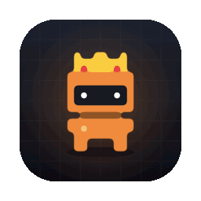</p>

<p align="center"></p>

<h1 align="center">Agentville</h1>

<p align="center">
See your Claude Code, Codex and GitHub Copilot agents at work.<br>
A Mac app that turns every running session into a little cartoon agent.
</p>


<p align="center">Dress the floor up in thirteen themes and draw the agents in four styles.</p>

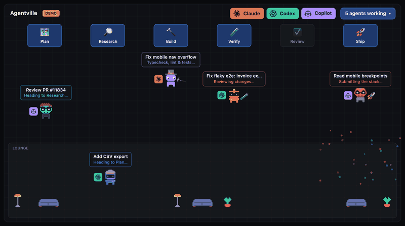

## What you get

**Working** — each agent stands at the station that matches what it is doing, tool in hand.

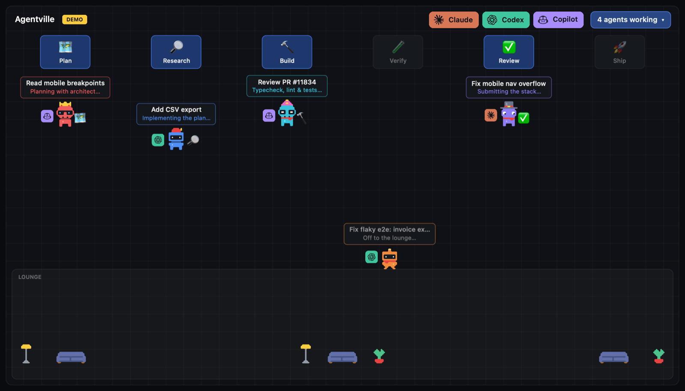

**Idle** — agents waiting on you head to the lounge and fall asleep.

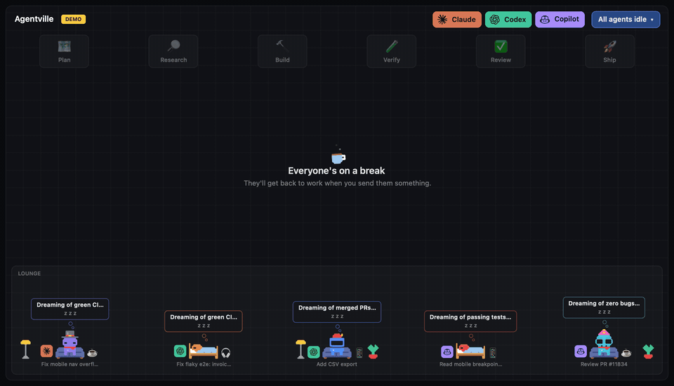

**Nobody home** — the dog keeps watch until a session starts.


**Themes** — thirteen looks for the floor, from the theme button in the title bar: Workshop,
Daylight, Forest, Ocean, Space, Sunset, Terminal and Winter, plus fan tributes to The Simpsons,
Star Wars, Lord of the Rings and Harry Potter. Lord of the Rings has two scenes, Mordor and the
Shire, picked in a section of their own once it is chosen. Each has its own colours and a little
ambience: fireflies in the forest, bubbles in the ocean, stars, embers, snow, CRT scanlines,
cartoon clouds over a sunny suburb, a jump to lightspeed, ash and embers over a volcanic
wasteland watched by a fiery eye, butterflies over green hills with round-doored hill houses for
a lounge, and a great hall with an enchanted starry ceiling, glowing arched windows, house
banners, a passing owl and floating candles, whose stations light up in four banner colours. The tributes are listed on their own, under Film & TV. Picking one dresses the
agents in costume; going back to an everyday theme puts your style back.

<table>
<tr>
<td><p align="center">Workshop</p></td>
<td><p align="center">Daylight</p></td>
</tr>
<tr>
<td><p align="center">Forest</p></td>
<td><p align="center">Ocean</p></td>
</tr>
<tr>
<td><p align="center">Space</p></td>
<td><p align="center">Sunset</p></td>
</tr>
<tr>
<td>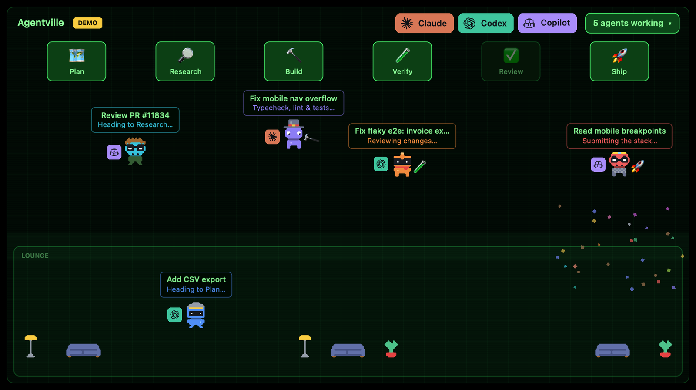<p align="center">Terminal</p></td>
<td><p align="center">Winter</p></td>
</tr>
<tr>
<td>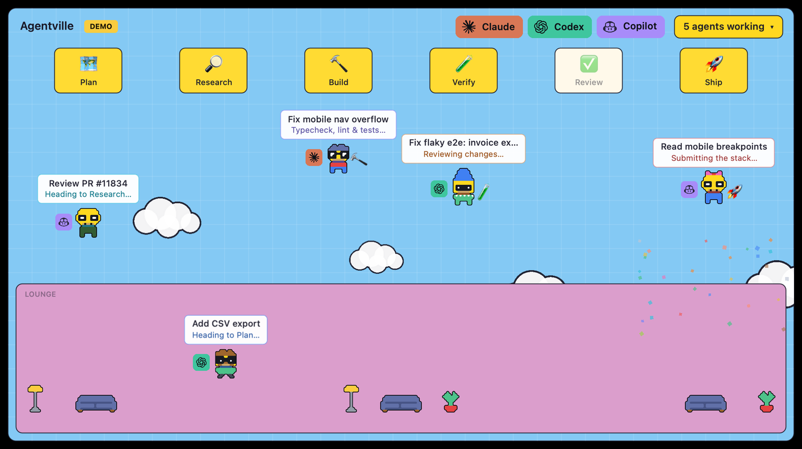<p align="center">The Simpsons</p></td>
<td>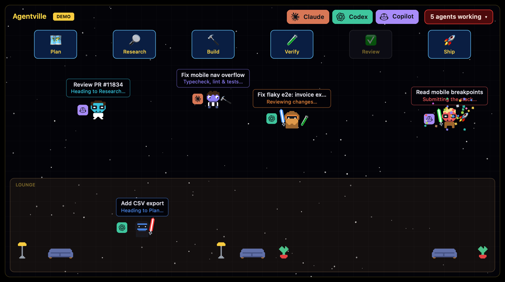<p align="center">Star Wars</p></td>
</tr>
<tr>
<td>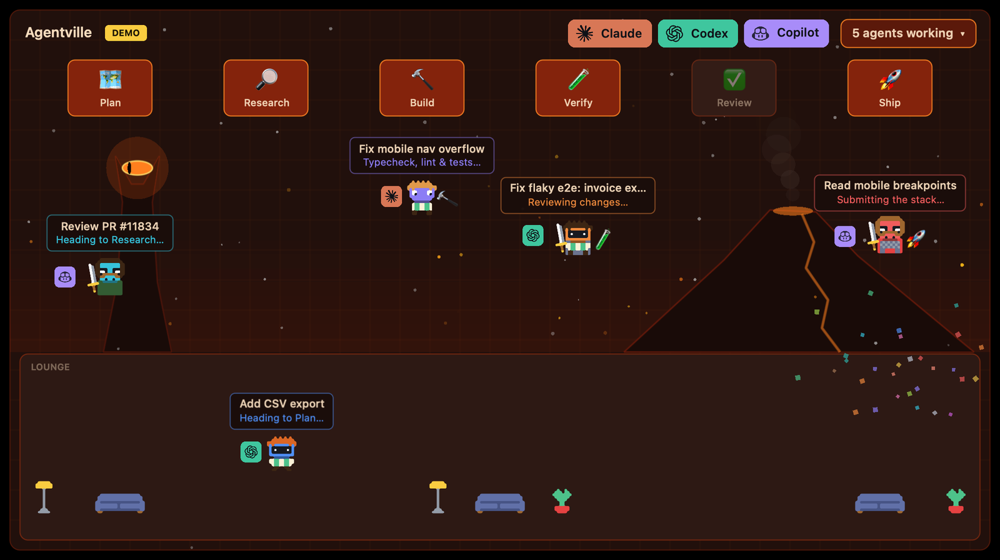<p align="center">Lord of the Rings: Mordor</p></td>
<td>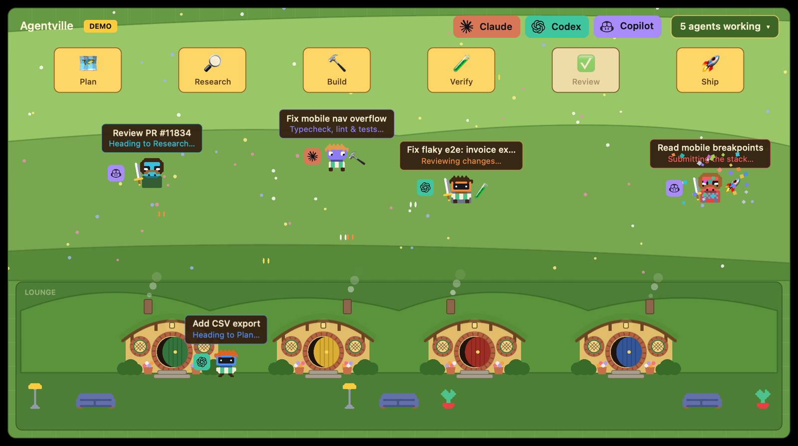<p align="center">Lord of the Rings: The Shire</p></td>
</tr>
<tr>
<td>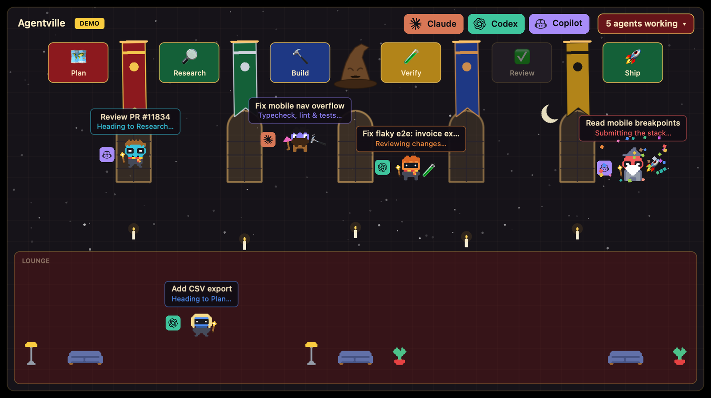<p align="center">Harry Potter</p></td>
<td></td>
</tr>
</table>

**Agent styles** — every theme can draw the agents smooth or as pixel art, from the same menu.
The everyday themes add yellow-skinned sitcom toons. The Simpsons starts in Toon, and its agents
stay yellow in Smooth and Pixel too. Star Wars adds flickering blue holograms.

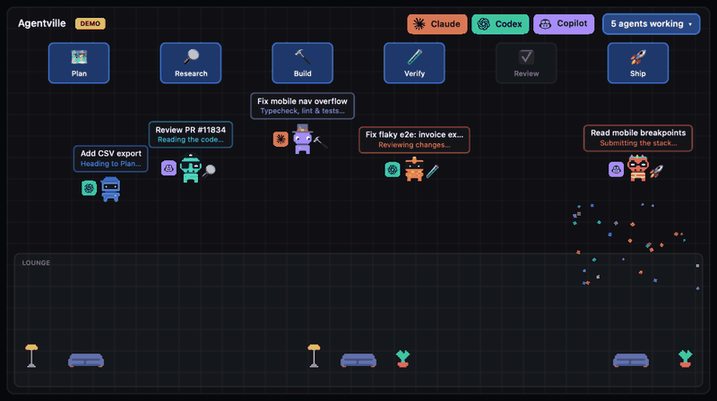

<table>
<tr>
<td>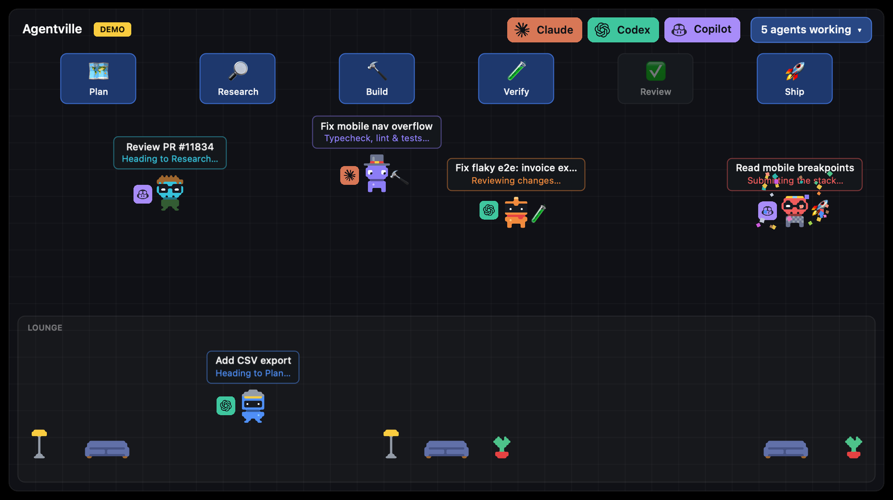<p align="center">Smooth</p></td>
<td><p align="center">Pixel</p></td>
</tr>
<tr>
<td>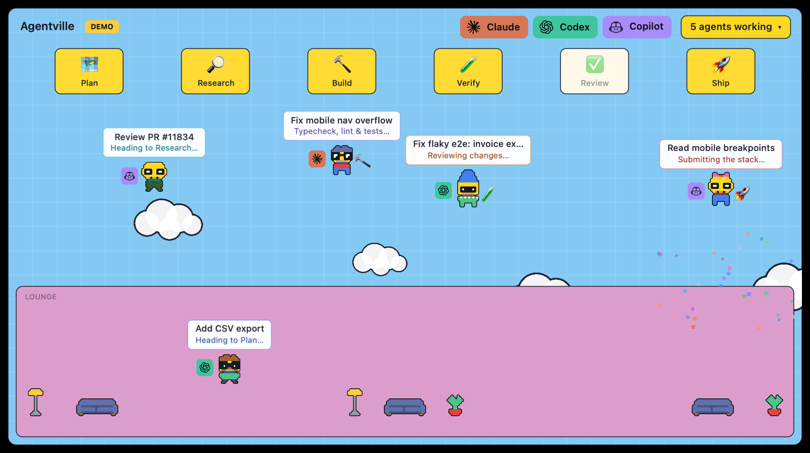<p align="center">Toon</p></td>
<td>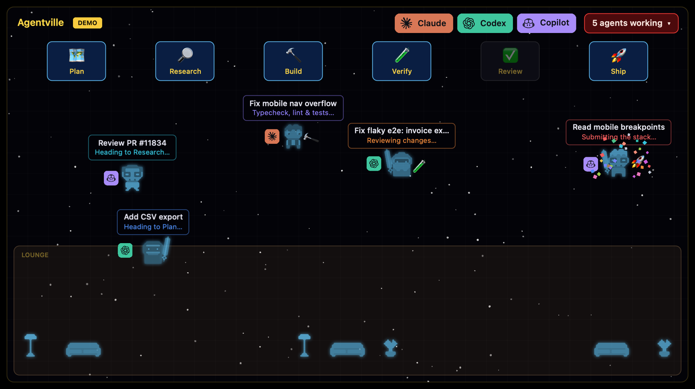<p align="center">Hologram</p></td>
</tr>
</table>

**App icon** — dress the app's own icon as your favourite character with the **App Icon** button
in the title bar. It previews every character; pick one and choose **Use as App Icon**. The Dock
and Finder both show it; pick **Crown (default)** to go back.

**Characters** — on the film and TV themes, agents are cast as the characters from that world.
Each character is played by one agent at a time, so there is only ever one wizard; agents only
play extras once every character is taken. Star characters under **Favourite characters** in the
theme menu and they are shown first. Click an agent to see who it is playing.

**The Simpsons** — everyone stays yellow, whichever style. Extras play townspeople.

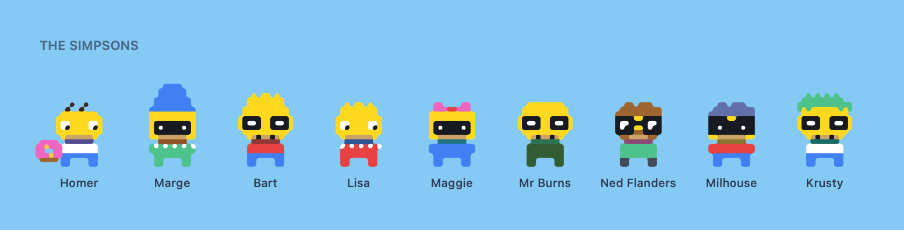

**Star Wars** — extras play stormtroopers, pilots and Jedi.

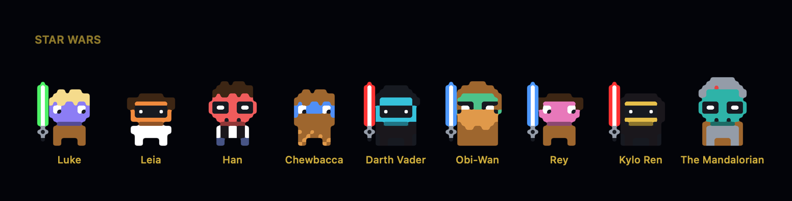

**Lord of the Rings** — in both Mordor and the Shire. Extras play hobbits, elves and rangers.

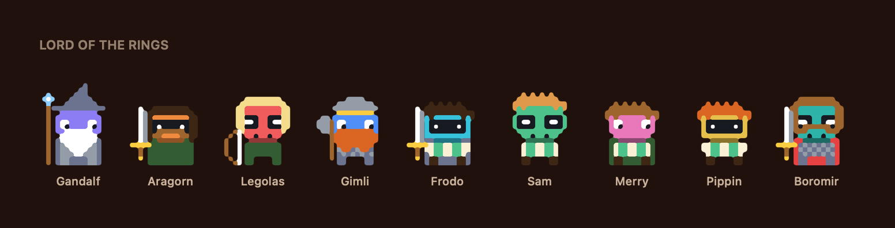

**Harry Potter** — extras play pupils in school robes.

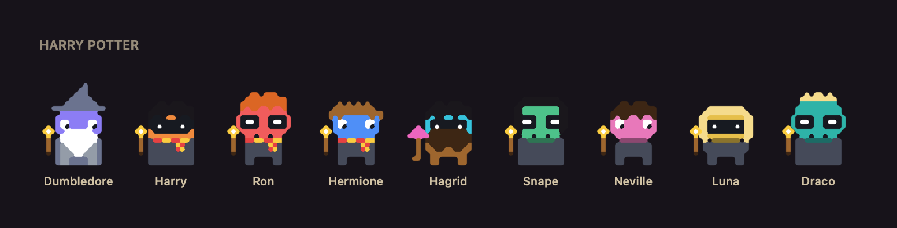

**Wardrobe** — every agent gets its own look, kept for as long as the session lives: one of 35
hats, hairstyles and helmets, glasses, a mustache or a beard, something round its neck, a
pattern or an outfit, and one of 15 colours.

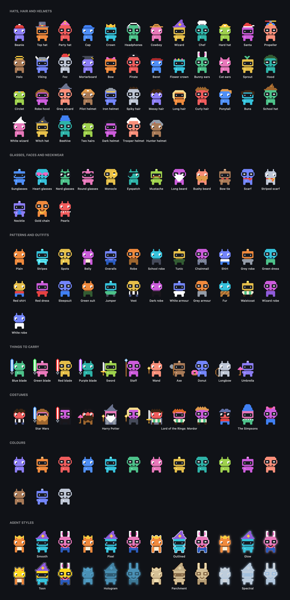

**Agent list and close-up** — open the list from the header, or click an agent to see its recent tasks.

<p align="center">

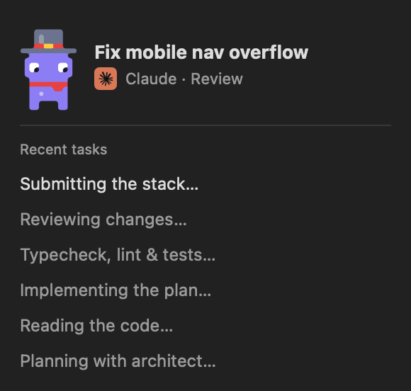
</p>

Also: filter by provider from the legend, keep the window on top, and a menu bar counter of
agents at work.

## Install

Requires macOS 14 or later on an Apple silicon Mac.

**Download**

1. Download `Agentville.zip` from the [latest release](https://github.com/danfar93/agentville/releases/latest) and unzip it.
2. Drag **Agentville** into your Applications folder.
3. Open it, and allow it the first time (see below).

**Opening it the first time**

macOS blocks Agentville on first launch. Apple only lets an app open without a warning if its
developer has paid for an Apple Developer account and sent the app to Apple to be checked
("notarised"). Agentville is a free hobby project that has not been through that, so macOS
cannot vouch for it and asks you to confirm. You only do this once. The source code is all in
this repository if you would rather read it or build it yourself.

1. Double-click Agentville. macOS says it was not opened. Click **Done**, not "Move to Bin".

   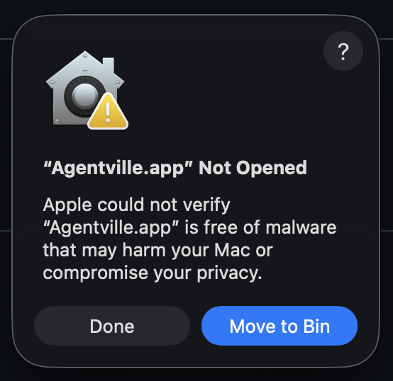

2. Open **System Settings → Privacy & Security** and scroll down to Security. Click
   **Open Anyway** next to the message about Agentville.

   

3. In the dialog that follows, click **Open Anyway**. macOS may ask for your password or Touch ID.

   

From then on Agentville opens normally.

Prefer Terminal? This one command does the same thing:

```sh
xattr -dr com.apple.quarantine /Applications/Agentville.app
```

**Or build it yourself** (needs Xcode 15 or later)

```sh
git clone https://github.com/danfar93/agentville.git
cd agentville
./scripts/bundle.sh
open build/Agentville.app
```

Then start a Claude Code, Codex or Copilot CLI session and its agent walks in.

The theme and agent-style pictures in this README come from the scripted demo:
`./scripts/screenshots.sh` renders them on a Mac, and CI runs it for any commit whose message
contains `[screenshots]`.

## How it works

Agentville only reads the session logs these tools already write to `~/.claude`, `~/.codex`
and `~/.copilot`. It changes nothing, needs no sign-in, and makes no network requests.

An agent's station is worked out from what its session is doing:

| Station | When the session is… |
|---|---|
| 🗺️ Plan | planning or updating a to-do list |
| 🔎 Research | reading and searching files, or the web |
| 🔨 Build | editing files |
| 🧪 Verify | running tests, linters or builds |
| ✅ Review | looking at diffs and pull requests |
| 🚀 Ship | committing, pushing or opening a pull request |

## Built with

A native Mac app in Swift, with no third-party dependencies.

| | |
|---|---|
| **SpriteKit** | The floor itself: the agents walking between stations, their tools, the lounge, the weather and ambience, and the confetti. |
| **SwiftUI** | The window's controls, the theme menu, the agent list and the close-up of an agent, and the menu bar item. |
| **Core Graphics** | Draws every character. Agents, hats, beds and furniture are written as small grids of letters, one letter per colour, and painted into textures at launch, so there are no image files for them. |
| **Swift Package Manager** | Builds the app and runs the tests; `scripts/bundle.sh` wraps the result into `Agentville.app`. |

**How the characters are drawn**

- **One drawing, several styles.** Each agent starts as a 12-wide grid of letters. *Pixel* paints
  one hard square per letter. *Smooth* blurs each colour into a soft field and redraws the edges
  where those fields meet, which rounds off the corners. *Toon* and *Hologram* are finishes on top
  of Smooth: thick ink lines, or a flickering blue glow with scanlines.
- **Outfits are random but stable.** Each agent's hat, accessory and costume are picked from a
  hash of its session ID, so agents look different from one another but each keeps the same
  look every time you open the app.
- **Provider logos** are the official marks, recoloured at launch to sit on each provider's tile.

**Reading the sessions**

- Session logs are JSON Lines files, followed as they grow, the way `tail -f` does.
- Codex thread names come from Codex's own SQLite database, opened read-only.
- What an agent is doing is worked out from each tool call and shell command it makes; see the
  station table above.

**Around the app**

- **XCTest** covers the log readers and the station logic.
- **GitHub Actions** builds and tests every push, and regenerates the README's screenshots when
  asked to.
- **Python** with Pillow turns recorded frames into the GIFs.

## Good to know

- Only sessions on this Mac are shown, not cloud or remote ones.
- Codex and Copilot agents appear when their first turn starts and leave ten minutes after their last activity.
- Copilot Chat inside VS Code is not shown, only the Copilot CLI. Copilot support has not yet been tried against a real session.
- The session log formats are not official and may change; if they do, agents may lose detail until the app is updated.

## Credits

The Claude, OpenAI and GitHub Copilot logos are trademarks of their owners and are used here
only to label each agent's provider.

The Simpsons, Star Wars, The Lord of the Rings and Harry Potter are trademarks of their
respective owners. The themes named after them are fan tributes: Agentville is not affiliated
with or endorsed by any of them, and uses no artwork, characters or logos from them.
