<p align="center">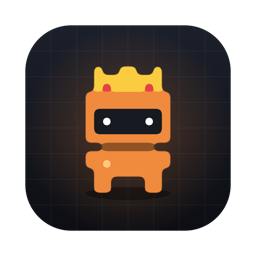</p>

<p align="center"></p>

<h1 align="center">Agentville</h1>

<p align="center">
See your Claude Code, Codex and GitHub Copilot agents at work.<br>
A Mac app that turns every running session into a little cartoon agent.
</p>

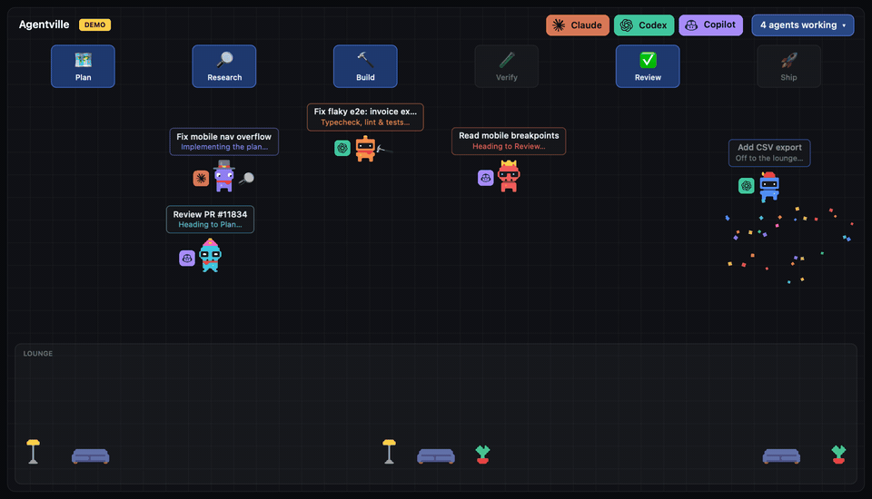

## What you get

**Working** — each agent stands at the station that matches what it is doing, tool in hand.


**Idle** — agents waiting on you head to the lounge and fall asleep.


**Nobody home** — the dog keeps watch until a session starts.

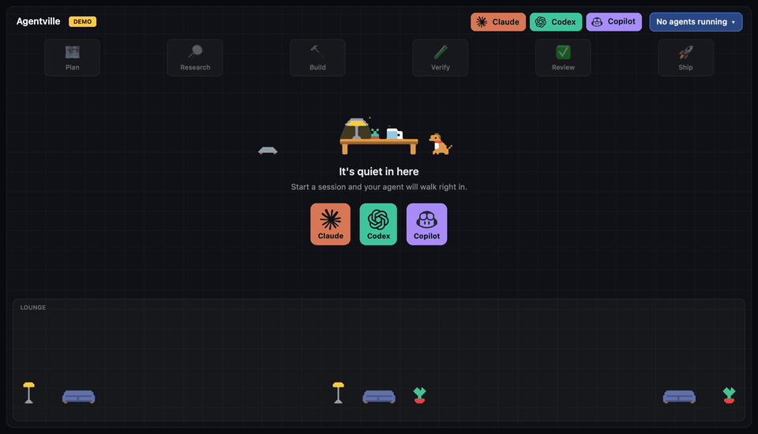

**Themes** — eight looks for the floor, from the palette menu in the title bar: Workshop, Daylight,
Forest, Ocean, Space, Sunset, Terminal and Winter. Each has its own colours and a little
ambience: fireflies in the forest, bubbles in the ocean, stars, embers, snow, and CRT scanlines.


<table>
<tr>
<td>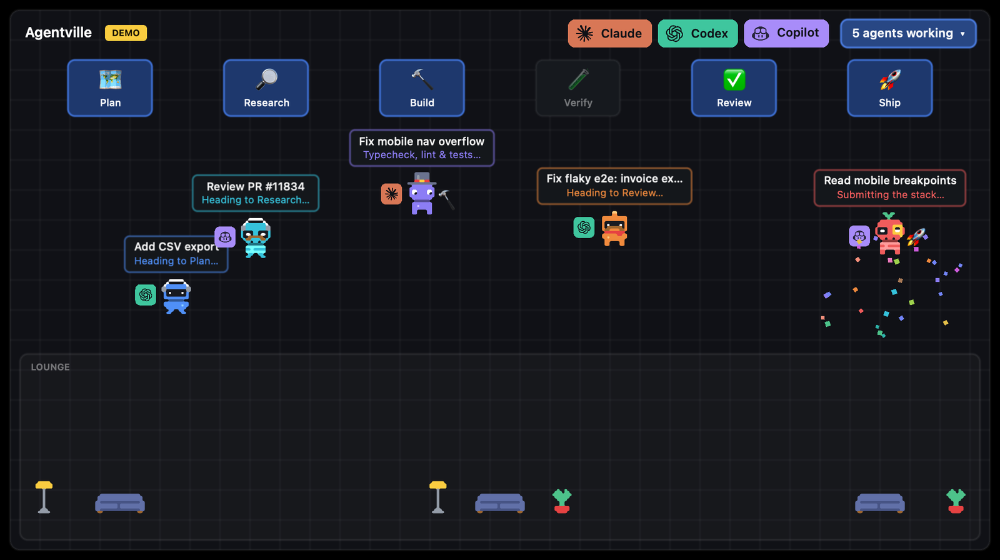<p align="center">Workshop</p></td>
<td>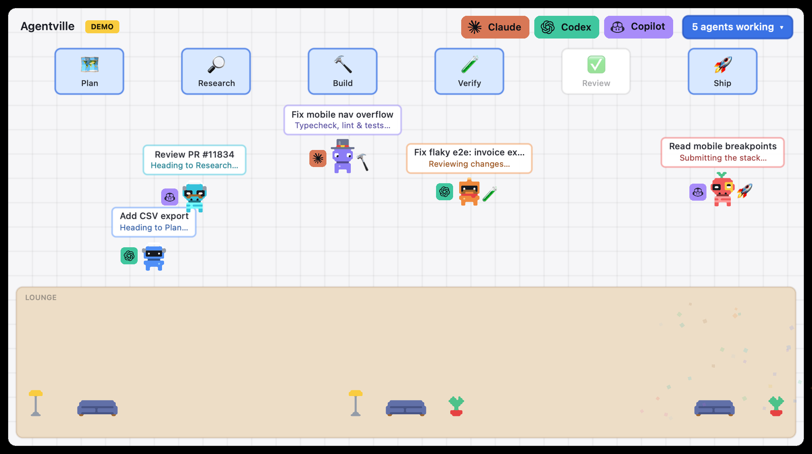<p align="center">Daylight</p></td>
</tr>
<tr>
<td>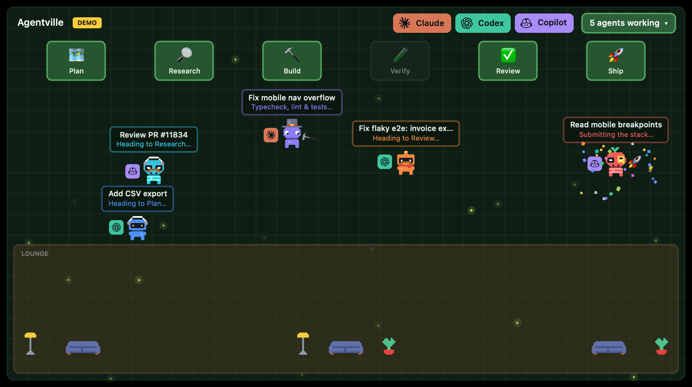<p align="center">Forest</p></td>
<td>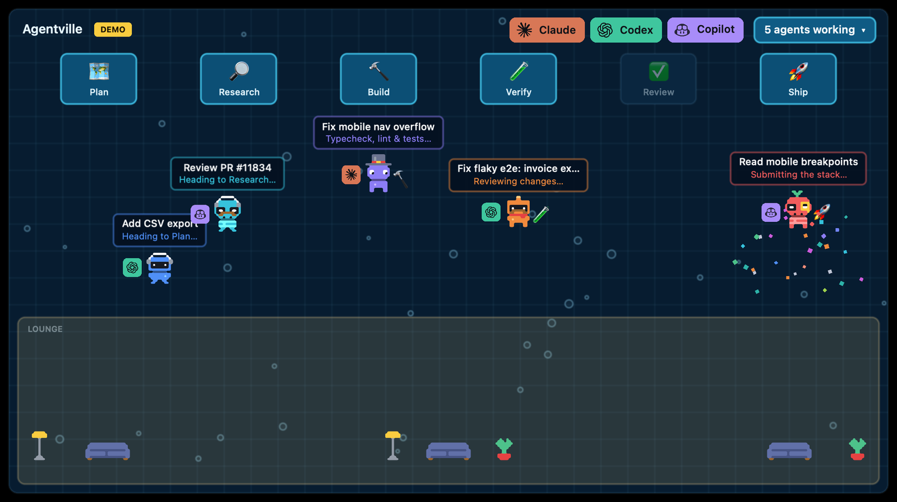<p align="center">Ocean</p></td>
</tr>
<tr>
<td>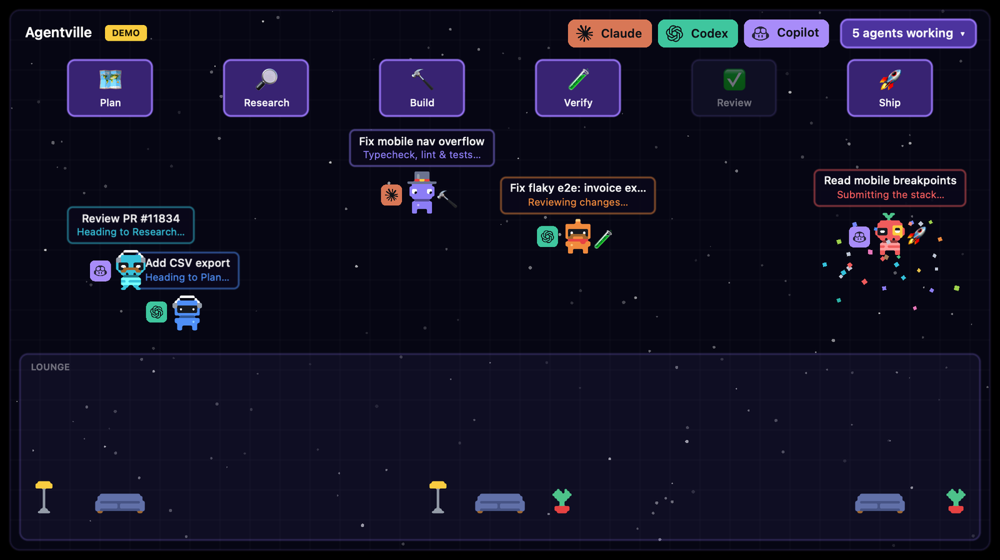<p align="center">Space</p></td>
<td>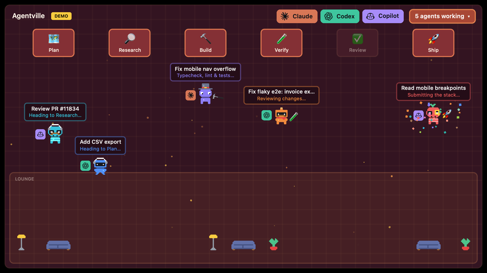<p align="center">Sunset</p></td>
</tr>
<tr>
<td><p align="center">Terminal</p></td>
<td>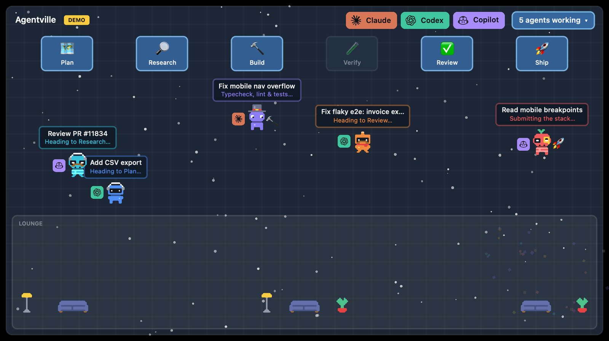<p align="center">Winter</p></td>
</tr>
</table>

**Agent styles** — draw the agents smooth, as pixel art, with a cartoon outline, or glowing.
Same menu.

<table>
<tr>
<td><p align="center">Smooth</p></td>
<td>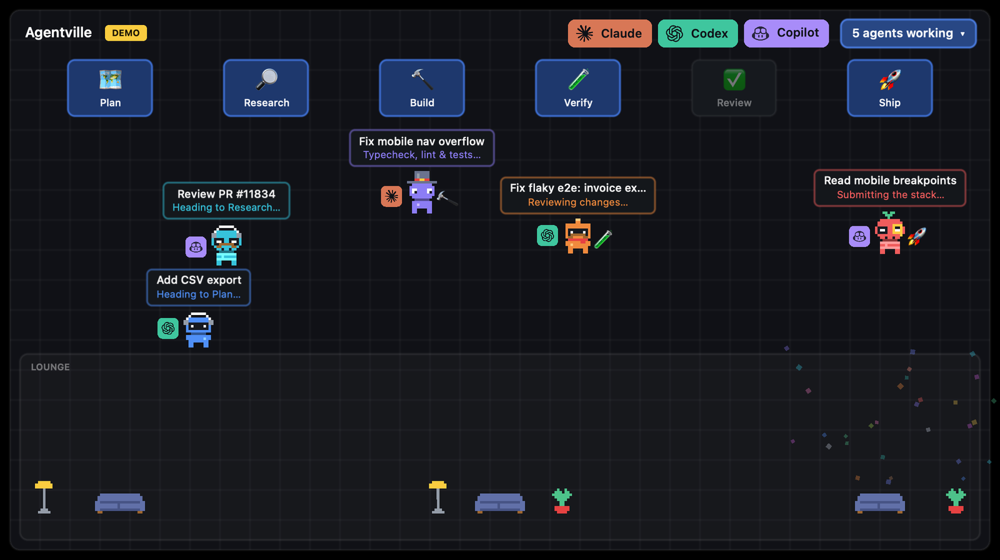<p align="center">Pixel</p></td>
</tr>
<tr>
<td>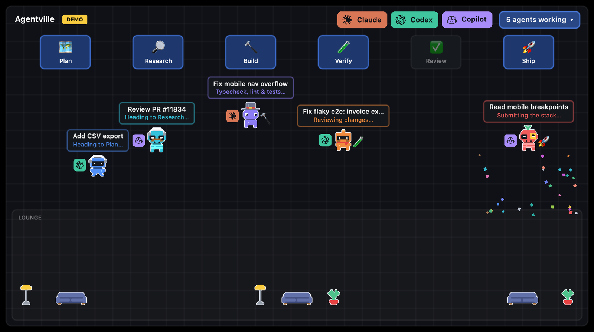<p align="center">Outlined</p></td>
<td>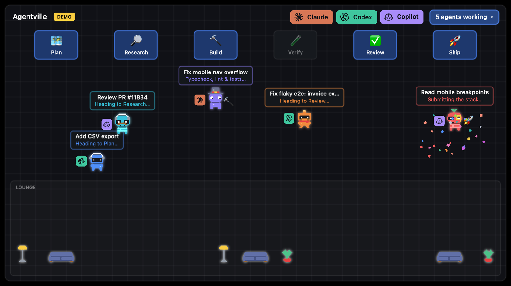<p align="center">Glow</p></td>
</tr>
</table>

**Wardrobe** — every agent gets its own look, kept for as long as the session lives: one of 23
hats, glasses or a mustache, something round its neck, stripes, spots, a belly patch or
overalls, and one of 15 colours.


**Agent list and close-up** — open the list from the header, or click an agent to see its recent tasks.

<p align="center">
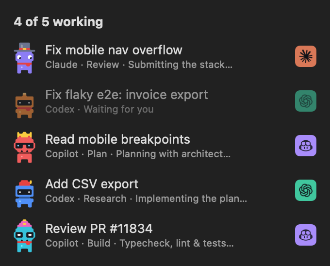

</p>

Also: filter by provider from the legend, keep the window on top, and a menu bar counter of
agents at work.

## Install

Requires macOS 14 or later on an Apple silicon Mac.

**Download**

1. Download `Agentville.zip` from the [latest release](https://github.com/danfar93/agentville/releases/latest) and unzip it.
2. Drag **Agentville** into your Applications folder.
3. Open it, and allow it the first time (see below).

**Opening it the first time**

macOS blocks Agentville on first launch. Apple only lets an app open without a warning if its
developer has paid for an Apple Developer account and sent the app to Apple to be checked
("notarised"). Agentville is a free hobby project that has not been through that, so macOS
cannot vouch for it and asks you to confirm. You only do this once. The source code is all in
this repository if you would rather read it or build it yourself.

1. Double-click Agentville. macOS says it was not opened. Click **Done**, not "Move to Bin".

   

2. Open **System Settings → Privacy & Security** and scroll down to Security. Click
   **Open Anyway** next to the message about Agentville.

   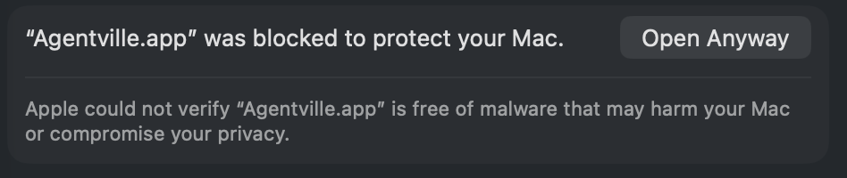

3. In the dialog that follows, click **Open Anyway**. macOS may ask for your password or Touch ID.

   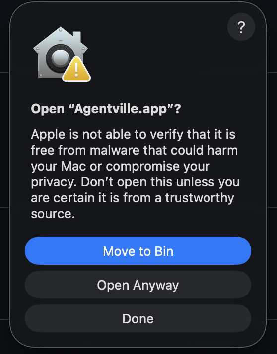

From then on Agentville opens normally.

Prefer Terminal? This one command does the same thing:

```sh
xattr -dr com.apple.quarantine /Applications/Agentville.app
```

**Or build it yourself** (needs Xcode 15 or later)

```sh
git clone https://github.com/danfar93/agentville.git
cd agentville
./scripts/bundle.sh
open build/Agentville.app
```

Then start a Claude Code, Codex or Copilot CLI session and its agent walks in.

The theme and agent-style pictures in this README come from the scripted demo:
`./scripts/screenshots.sh` renders them on a Mac, and CI runs it for any commit whose message
contains `[screenshots]`.

## How it works

Agentville only reads the session logs these tools already write to `~/.claude`, `~/.codex`
and `~/.copilot`. It changes nothing, needs no sign-in, and makes no network requests.

An agent's station is worked out from what its session is doing:

| Station | When the session is… |
|---|---|
| 🗺️ Plan | planning or updating a to-do list |
| 🔎 Research | reading and searching files, or the web |
| 🔨 Build | editing files |
| 🧪 Verify | running tests, linters or builds |
| ✅ Review | looking at diffs and pull requests |
| 🚀 Ship | committing, pushing or opening a pull request |

## Good to know

- Only sessions on this Mac are shown, not cloud or remote ones.
- Codex and Copilot agents appear when their first turn starts and leave ten minutes after their last activity.
- Copilot Chat inside VS Code is not shown, only the Copilot CLI. Copilot support has not yet been tried against a real session.
- The session log formats are not official and may change; if they do, agents may lose detail until the app is updated.

## Credits

The Claude, OpenAI and GitHub Copilot logos are trademarks of their owners and are used here
only to label each agent's provider.
